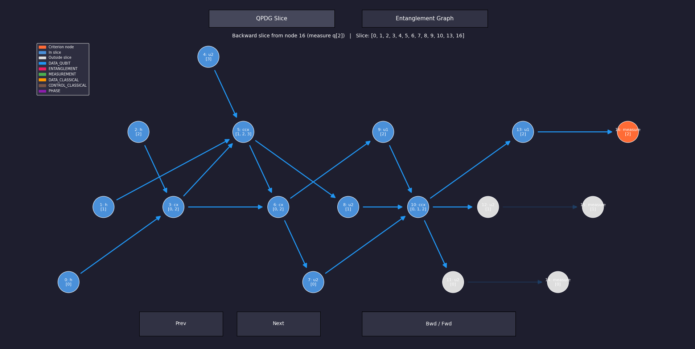
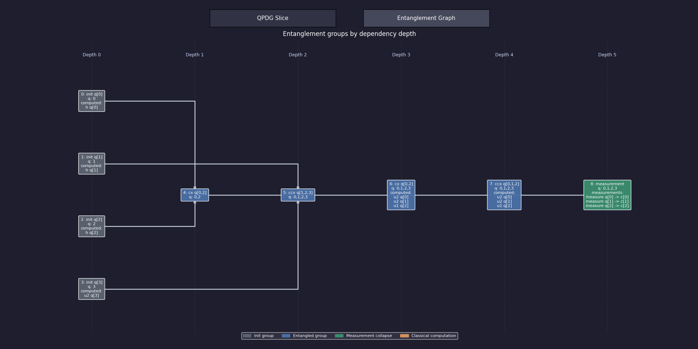

# Quantum Program Slicer

Static slicing for quantum programs. Give it a circuit written in **Qiskit
(Python)** or **OpenQASM 2/3**, and it builds a **Quantum Dependency Graph
(QDG)**, then answers the question a developer actually has:

> Which instructions can influence this measurement, and what does this gate
> go on to affect?

A **backward slice** from an instruction collects everything it depends on. A
**forward slice** collects everything it can affect. Both are graph
reachability over the QDG, restricted to whichever dependency types you choose,
and both are shown in a web app that links every graph node back to the source
line that produced it.

The analysis is **static**. The recommended front ends read your program
without running it, so you can analyse code you did not write.

## Contents

1. [Quick start: the web app](#quick-start-the-web-app)
2. [Front ends: static first](#front-ends-static-first)
3. [Using the web app](#using-the-web-app)
4. [Linters and the Bugs4Q benchmark](#linters-and-the-bugs4q-benchmark)
5. [Quick start: the library](#quick-start-the-library)
6. [How it works](#how-it-works)
7. [Dependency types](#dependency-types)
8. [Static parsing in detail](#static-parsing-in-detail)
9. [Source locations](#source-locations)
10. [Repository layout](#repository-layout)
11. [Testing](#testing)
12. [Deployment](#deployment)
13. [Documentation](#documentation)
14. [Status and limitations](#status-and-limitations)

## Quick start: the web app

Requires Python 3.10+.

```bash
pip install -r requirements.txt
pip install -r webapp/requirements.txt
python webapp/app.py
```

Open <http://127.0.0.1:5000/>, go to **Slicer**, pick an example, choose a
static interpreter, press **Analyze**, then click any node in the graph.

## Front ends: static first

The Interpreter dropdown offers four front ends. Which one runs is always your
explicit choice: loading an example or uploading a file sets the dropdown from
the file extension, and nothing else changes it. If the text and the choice
disagree, the error says so instead of guessing.

| Interpreter | How it gets the circuit | Executes your code? | Source lines |
|---|---|---|---|
| **Qiskit (Python, static)** | Parses with `ast` and interprets the tree with its own interpreter | **No** | Yes |
| **OpenQASM 2/3 (static)** | The `openqasm3` reference parser plus its own interpreter | **No** | Yes |
| Qiskit (Python) | Runs the file in a worker process and keeps the largest `QuantumCircuit` | **Yes** | No |
| OpenQASM 3 | `qiskit.qasm3.load` builds a circuit from the text | No | No |

**Prefer the two static front ends.** They are safe on untrusted input and they
are the only ones that record where each instruction came from, which powers
the source highlighting in the app. The executing Qiskit route remains for
comparison and for programs the static interpreter cannot yet follow. It
**executes the submitted file** in a child process with a timeout (default 20 s,
`QSLICER_PARSE_TIMEOUT`) and a scratch working directory. That bounds
accidents. **It is not a sandbox.** Do not expose it to untrusted users.

The dropdown currently starts on the executing "Qiskit (Python)" option.
Switch it to a static option for the behaviour described in this README.

## Using the web app

| Page | Purpose |
|---|---|
| `/` | Landing page |
| `/slicer` | The application: source on the left, graph and analysis on the right |
| `/benchmark` | Grade the selected lint rules on the Bugs4Q bugs |
| `/quantum` | Background on quantum programs, the QDG and the tools used |

On the slicer page:

- **Example, upload or paste.** 24 bundled circuits (22 Qiskit, 2 OpenQASM)
  are grouped as Basics, Algorithms, Communication protocols, Analysis
  showcases and OpenQASM.
- **Click a node** to slice from it. Toggle backward or forward in the toolbar.
- **Follow chips** choose which dependency types the traversal may use. They
  are passed straight to the slicer, so they are a real filter, and they are
  built from the rules that actually ran, with the edge count each contributed.
- **Source links, both directions.** Hover a node or table row to highlight its
  line. A slice highlights every source line it covers and scrolls to the
  criterion. Click a gutter line number to see which nodes that line produced.
- **Lint** picks the linters and individual rules that run on Analyze. The
  choice is remembered in the browser and shared with the Benchmark page.
- **Instructions tab** lists every instruction with its line; **Console** shows
  the program's output (executing route only); **diagnostics** list lint
  findings and parser warnings, each jumping to its line.
- **Range**, drag-to-move nodes, relayout, zoom/fit, a resizable divider, and
  **PNG export**.
- Parse errors name the failing stage and mark the offending line in the gutter.

The JSON API behind it:

| Endpoint | Method | Body |
|---|---|---|
| `/api/examples` | GET | none |
| `/api/examples/<key>` | GET | none |
| `/api/analyze` | POST | `{source, filename, profile, language, lint_rules}` |
| `/api/slice` | POST | `{token, node_idx, direction, dep_types}` |
| `/api/linters` | GET | none |
| `/api/benchmark` | GET | none (the Bugs4Q bug list) |
| `/api/benchmark/bugs/<key>` | GET | none |
| `/api/benchmark` | POST | `{lint_rules, profile}` |

`language` is one of `qiskit`, `qiskit-static`, `qasm`, `qasm-static`.
`/api/analyze` returns nodes (each with `line` and `source`), edges,
entanglement groups, diagnostics and a `token` naming the cached QDG, so
slicing never re-parses. The cache holds the 24 most recent analyses in memory.

The full front-end reference (editor, graph view, math notation, the mocked and
partial features) is in [webapp/README.md](webapp/README.md).

## Linters and the Bugs4Q benchmark

Linters register in `webapp/linters.py`, each with its own rules. A request
selects rules by id (`quick/QS002`, `dependence/QD01`, or a bare linter id for
all of its rules); `lint_rules` omitted means the default selection.

| Linter | Id | Reads | Default |
|---|---|---|---|
| Quick checks | `quick` | the Python syntax tree (`webapp/lint.py`) | on |
| Dependence checks | `dependence` | the static IR and its QDG: dead gates, overwritten and constant measurements | off |

A new linter is a module in `webapp/linter_plugins/` that defines `LINTER`
(see `dependence_checks.py`), or any importable module named in
`QSLICER_LINTER_PLUGINS`. It then appears in the Lint menu, the benchmark and
the command line with no other change.

The **Benchmark** page grades the current selection on the 62 Qiskit bugs of
[Bugs4Q](https://github.com/Z-928/Bugs4Q-NA), vendored under
`benchmarks/bugs4q/`. A rule *detects* a bug when it warns on a line the fix
changed and the fix makes it fire less. Each selected linter is reported alone
and combined, beside any recorded run of another tool (for example LintQ,
imported from SARIF). The same from the command line:

```bash
python benchmarks/run_bugs4q.py --rules quick,dependence
```

See [benchmarks/bugs4q/README.md](benchmarks/bugs4q/README.md) for the dataset,
its license, and how to compare another tool.

## Quick start: the library

The modules in `scripts/` import each other by bare name, so put `scripts/` on
the path (or run from inside it):

```python
import sys
sys.path.insert(0, "scripts")

from Parsers.staticqiskitparser import StaticQiskitParser
from qdg import QDG
from slicer import QuantumSlicer, SlicingCriterion

# Read a Qiskit program WITHOUT executing it
parser = StaticQiskitParser()
program = parser.parse_file("webapp/examples/bell_pair.py")
print(parser.warnings)                        # anything skipped or approximated

# Every instruction knows its source line
for i, ins in enumerate(program.instructions):
    print(i, ins.name, "line", ins.location.line)

graph = QDG(program)                          # default rules

# Backward slice from the last instruction
last = len(program.instructions) - 1
print(sorted(QuantumSlicer.backward_slice(graph, SlicingCriterion(node_idx=last))))
```

OpenQASM works the same way:

```python
from Parsers.staticopenqasmparser import StaticOpenQASMParser

program = StaticOpenQASMParser().parse_file("webapp/examples/ghz_openqasm.qasm")
```

Both parsers raise `StaticParseError` with a line number when the circuit
cannot be determined. Restrict a slice with
`SlicingCriterion(node_idx, dep_types={DependencyType.DATA_QUBIT})` (import
`DependencyType` from `Dependencies.dependency_rules`) and use
`QuantumSlicer.forward_slice` for the other direction.

### Command-line visualisation

`scripts/combined_visualizer.py` draws the QDG and the entanglement graph with
matplotlib. It still uses the executing `QiskitParser`, so use it on circuits
you trust:

```bash
python scripts/combined_visualizer.py --circuit_path 'Attachments/Sample Code/grovers_algorithm_exception.py'
```




## How it works

```
 .py  ──ast──▶ Python interpreter ─┐
                                   ├─▶ circuit model ─▶ QuantumProgram (IR) ─▶ QDG ─▶ slicer ─▶ web payload
 .qasm ─openqasm3─▶ QASM interpreter ┘     (shared)      + SourceLocation
```

1. **Parse.** A front end turns the program into the frontend-agnostic IR, a
   `QuantumProgram` of `QuantumInstruction`s: gate name, qubit and classical-bit
   operands, parameters, and a `SourceLocation`.
2. **Build the QDG.** Each instruction becomes a node. Dependency rules scan the
   program in order and add edges labelled with their dependency type.
3. **Slice.** Breadth-first traversal along incoming (backward) or outgoing
   (forward) edges, optionally filtered by dependency type. A slice always
   contains its criterion.
4. **Analyse entanglement (optional).** `EntanglementAnalyzer` approximates
   entanglement groups and marks each active, uncomputed or measured.

Everything after the IR is independent of which front end produced it. Adding a
dependency type needs only a new rule class, with no change to the slicer.

## Dependency types

| Type | Meaning | Default |
|---|---|---|
| **DataQubit** | A gate writes a qubit; later gates on it depend on the writer | on |
| **Measurement** | An operation conditioned on a measurement depends on it | on |
| **DataClassical** | Reaching definitions on classical bits | on |
| **ControlClassical** | Control dependence; a placeholder emitting no edges yet | on, empty |
| **Entanglement** | Links an entangling gate to later operations on entangled qubits | off |
| **Phase** | Dependencies through phase-changing gates | off |

Entanglement matters because a gate that entangles two qubits changes what a
later measurement of either means, unless it is **uncomputed** first (applied
again in reverse). Entanglement is approximated syntactically: groups merge when
an entangling gate spans them, and self-inverse gates applied twice cancel. It
misses cancellations that need state tracking, such as `S` then `S†`.

## Static parsing in detail

### Qiskit (Python)

`StaticQiskitParser` (`scripts/Parsers/staticqiskitparser.py`) does not
pattern-match `qc.h(0)`-shaped lines. It **interprets** the module's syntax
tree over a value domain it fully controls:

- Plain Python data, plus its own model of `QuantumCircuit`, registers, bits,
  gates and `Parameter`s.
- Imports are recorded, **never performed**. Anything only a real run could
  produce (a simulator result, `open(...)`, an unseeded random number) is an
  `Unknown`.

It covers arithmetic, containers, comprehensions, `for`/`while`/`if`, functions,
closures, lambdas, `try`/`except`, a whitelist of pure built-ins, `math`,
`itertools`, the basics of `numpy`, and **seeded** randomness, which calls the
real generator so angles match a real run. On the Qiskit side it handles every
standard gate with argument broadcasting, `measure`/`measure_all`, `barrier`,
`reset`, `mcx`, `append`, `compose`, `to_gate`, `inverse`, `decompose`,
`if_test`/`else`, parameters and the `qiskit.circuit.library` gates.

**Unknowns are harmless until the circuit needs them.** Post-processing such as
simulating, transpiling and plotting a result just becomes unknowns, so scripts
with a results section still parse. But an unknown used as a qubit index,
register size, or the condition of a loop or `if` that touches a circuit stops
the parse with the line number. An unknown gate angle is kept symbolic with a
warning, since parameters do not affect dependencies.

**Safety.** The interpreter never calls `import`, `eval`, `exec` or `compile`,
refuses any attribute starting with `_`, and bounds resources: 2,000,000
statements and loop iterations, 200,000 instructions, 40 nested calls, and
1,000,000 elements in anything it builds (checked before an expression like
`"x" * 10**9` is evaluated).

### OpenQASM 2/3

`StaticOpenQASMParser` uses the OpenQASM project's reference parser for syntax,
so coverage tracks the language specification, and its own interpreter for
meaning:

- `qubit`/`bit` and OpenQASM 2 `qreg`/`creg`; `const`, `input` and classical
  variables.
- `stdgates.inc` and `qelib1.inc` gates named as Qiskit names them; user `gate`
  definitions.
- Gate modifiers `inv @`, `ctrl @`, `negctrl @`, and `pow @` (kept as one
  instruction, with a warning).
- Measurement in both syntaxes, `reset`, `barrier`, `delay`.
- `if`/`else`, taken at compile time when computable, or kept as one `if_else`
  instruction when it compares a bit or register to a constant.
- **Loops are unrolled** and subroutines **inlined**, so each iteration's gates
  are separate nodes, which is better for slicing than an opaque loop.

It refuses, with a line number, `while` loops on measured values, `box`,
physical qubits and unsupported conditions. Unlike the `qiskit.qasm3` route it
reads OpenQASM 2 and register indexing by a loop variable.

### How close is it to executing?

| Check | Result |
|---|---|
| Static vs executing Qiskit parser, 35 programs | 32 identical. The other three are explained differences, not bugs |
| Same, through the running web app | 21 of 22 examples identical |
| Static OpenQASM vs `qiskit.qasm3` | Identical on both `.qasm` examples and a mixed program |
| Hostile input (dunder access, `eval`, runaway recursion, `9 ** 9 ** 9`) | Every case refused cleanly with a line |

The known differences: a script that keeps a transpiled copy at module level
makes the executing parser pick that copy while the static parser keeps the
circuit as written; `decompose()` of a composite such as QFT can order commuting
gates differently; and `mcrx`/`mcry`/`mcrz` stay one instruction each.

## Source locations

Every `QuantumInstruction` from a static parser carries a `SourceLocation`:
start line and column, end line and column, and a `via` tuple listing the lines
of the calls that led there, outermost first. A gate placed inside a helper
`entangle(qc, 0, 1)` points at its line in the helper and lists the call line
in `via`. Broadcast gates such as `qc.h(range(3))` share one location, and an
OpenQASM loop body is shared by every iteration. Front ends that cannot know a
location leave it `None`, and everything downstream treats that as "no link".

This is what lets the web app move between source and graph in both directions,
and it is why parse errors and warnings land on a line.

## Repository layout

```
.
├── scripts/                     Analysis library
│   ├── Parsers/
│   │   ├── staticqiskitparser.py     Static Qiskit front end (interpreter)
│   │   ├── staticopenqasmparser.py   Static OpenQASM 2/3 front end
│   │   ├── qiskitparser.py           Executing Qiskit front end
│   │   └── openqasmparser.py         qiskit.qasm3-based front end
│   ├── Dependencies/            Dependency types and the rules that emit edges
│   ├── qinstruction.py          QuantumInstruction and SourceLocation
│   ├── qprogram.py              QuantumProgram (the IR)
│   ├── parser.py                Abstract parser base class
│   ├── qdg.py                   QDG construction and rule profiles
│   ├── slicer.py                Backward and forward slicing
│   ├── entanglement.py          Approximate entanglement analysis
│   └── visualizer.py, entangle_viewer.py, combined_visualizer.py
├── webapp/                      Flask web app (see webapp/README.md)
│   ├── app.py, analysis.py      Routes and the bridge to scripts/
│   ├── parse_worker.py          Child process for the executing Qiskit route
│   ├── lint.py, gates.py        Static checks and the gate reference
│   ├── linters.py               Linter registry and rule selection
│   ├── linter_plugins/          Linter add-ons (dependence checks)
│   ├── benchmark.py             Bugs4Q grading and comparison
│   ├── examples/                Bundled circuits and manifest.json
│   └── templates/, static/      Pages, CSS, JavaScript (no build step, no CDN)
├── benchmarks/                  run_bugs4q.py and the vendored Bugs4Q dataset
├── deploy/                      nginx config and systemd unit
├── tests/                       core/, webapp/, benchmark/ and js/ suites
├── Attachments/                 Sample circuits and images
└── wiki/                        Research notes (separate repo)
```

## Testing

```bash
pytest                       # everything
pytest -m "not slow"         # skip tests that start the Qiskit worker subprocess
```

The suites are `tests/core` (parsers, QDG, rules, slicer, entanglement,
including both static parsers), `tests/webapp` (API, pages, routes, source
locations, lint, worker, benchmark pages), `tests/benchmark` (the Bugs4Q
dataset, grading, the linter registry and dependence checks) and `tests/js` (run through Node's built-in test
runner, so Node.js is required).

Known gaps are recorded as strict `xfail`s in
`tests/webapp/test_webapp_requirement_gaps.py`; one that starts passing fails the
run, which is the cue to remove the marker.

## Deployment

[deploy/README.md](deploy/README.md) covers nginx plus gunicorn under a
hardened systemd unit (`DynamicUser`, `IPAddressDeny=any`, memory and task
caps, a read-only filesystem), `waitress` on Windows, and logs. The service runs
**one worker with several threads on purpose**: the QDG cache is in process
memory, so a second worker would not recognise another's slice tokens.

For a public host, the safest configuration is to use only the static
interpreters, since they execute nothing. Restricting access in nginx
(`allow`/`deny`) is what decides who can reach the executing route.

## Documentation

The research notes live in the project wiki (a separate repository, checked
out under `wiki/`): classical and quantum slicing, the dependency types, the
approximate entanglement representation, uncomputation, LintQ, and static
parsing.

The static parsing page records the interpreter design, the validation, and a
proposal for **chunking** large programs: because
static parsing unrolls loops, a 4,000-layer, 20-qubit ansatz becomes about
156,000 IR nodes from three source sites. Every current rule keeps one "last
writer per wire" state, so a program can be cut along its source structure
(helper calls, loop iterations, `if` blocks), each chunk summarised at its
qubit/clbit boundary, and slices run over the summaries, expanding only the
chunks they enter. That is exact for the current rules, not an approximation.
It is a proposal, not yet implemented.

## Status and limitations

This is a research prototype. It analyses statically only, and conservative
approximations are accepted. Specifically:

- **Entanglement and phase rules ship disabled.** Only the `baseline` profile
  exists, so there is no per-analysis toggle yet.
- **Classical control dependence** (`ControlClassical`) is a placeholder, and
  slices do not yet exclude an entangling gate that is uncomputed before the
  criterion.
- **Qubit-wise (horizontal) slices** are computed in the browser;
  `SlicingCriterion.qubits` is not consumed by the slicer yet. The X/Y/Z
  measurement-basis toggle is a placeholder pending research.
- **Static checks** (`QS000`–`QS010`) read only Python source, are not LintQ,
  and see only literal arguments. OpenQASM input gets none.
- **Large circuits** (several hundred instructions and up) draw slowly, since
  each node is a DOM element; use Range. Chunking is the planned fix.
- **Static interpreter limits:** unmodelled code (user-defined classes,
  `transpile` and pass managers) is not followed, and control flow that depends
  on an unknown value and touches a circuit is refused rather than guessed.
- **Export** covers PNG; JSON export of a slice is not done.
