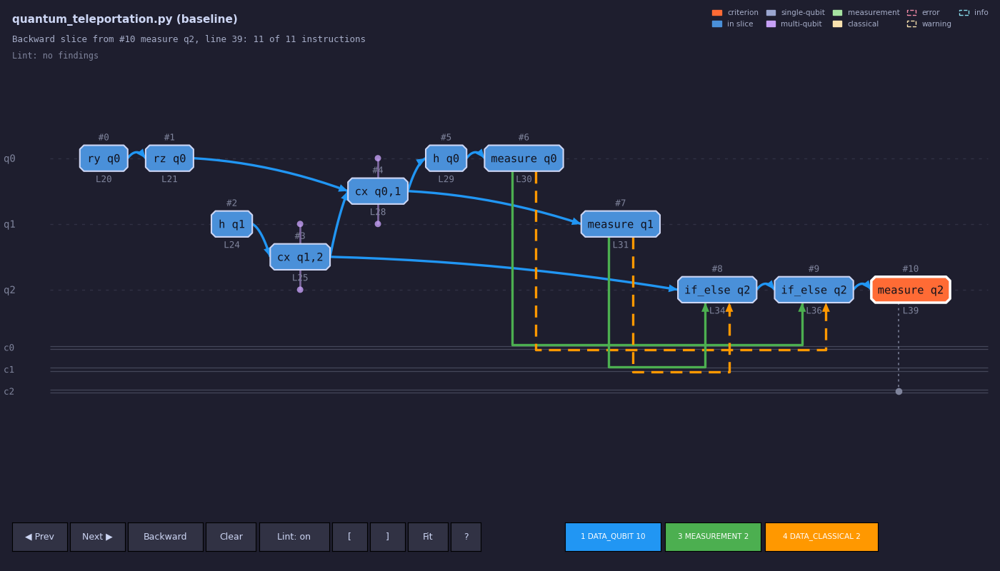

# Quantum Program Slicer

Static slicing for quantum programs. Give it a circuit written in **Qiskit
(Python)** or **OpenQASM 2/3**, and it builds a **Quantum Dependency Graph
(QDG)**, then answers the question a developer actually has:

> Which instructions can influence this measurement, and what does this gate
> go on to affect?

A **backward slice** from an instruction collects everything it depends on. A
**forward slice** collects everything it can affect. Both are graph
reachability over the QDG, restricted to whichever dependency types you choose,
and both are shown in a web app that links every graph node back to the source
line that produced it.

The analysis is **static**. The recommended front ends read your program
without running it, so you can analyse code you did not write.

It ships as the `qslicer` Python package, with a `qslicer` command for linting
and slicing your own files, and a Flask web app built on top of it.

```bash
pip install .                 # from a checkout; adds the `qslicer` command
qslicer lint my_circuit.py
qslicer slice my_circuit.py --line 12
```

## Contents

1. [Quick start: the web app](#quick-start-the-web-app)
2. [Front ends: static first](#front-ends-static-first)
3. [Using the web app](#using-the-web-app)
4. [Linters and benchmarks](#linters-and-benchmarks)
5. [Quick start: the package](#quick-start-the-package)
6. [How it works](#how-it-works)
7. [Dependency types](#dependency-types)
8. [Static parsing in detail](#static-parsing-in-detail)
9. [Source locations](#source-locations)
10. [Repository layout](#repository-layout)
11. [Testing](#testing)
12. [Deployment](#deployment)
13. [Documentation](#documentation)
14. [Status and limitations](#status-and-limitations)

## Quick start: the web app

Requires Python 3.10+.

```bash
pip install -r requirements.txt    # the exact versions the tests run on, plus Flask
pip install -e .                   # qslicer itself, editable
python webapp/app.py
```

Open <http://127.0.0.1:5000/>, go to **Slicer**, pick an example, press
**Analyze**, then click any node in the graph.

### Supported Qiskit version

The project is frozen at **Qiskit 2.6.0** (with qiskit-aer 0.17.2 and
qiskit-qasm3-import 0.6.0), pinned in `requirements.txt`; the package itself
asks for `qiskit>=2.6,<2.7` so it installs beside other 2.6.x tools. The static parsers,
the quick checks' list of removed APIs (QS011) and the LintQ port are
maintained against that version only; `tests/core/test_qiskit_version.py`
fails if a different one is installed. Programs written for older Qiskit still
analyse statically, and QS011 points out the APIs they use that 2.6.0 no
longer has. QS012 checks every `from qiskit... import` against the installed
Qiskit, so it catches names that never existed (`CNOT` from
`qiskit.circuit.library`) and follows the pin by itself. Moving to a new
version is a deliberate change: bump the three pins together, run the full
suite, and update this section.

## Front ends: static first

The Interpreter dropdown offers two front ends, one per language, and neither
executes your code. Which one runs is always your explicit choice: loading an
example or uploading a file sets the dropdown from the file extension, and
nothing else changes it. If the text and the choice disagree, the error says so
instead of guessing.

| Interpreter | `language` | How it gets the circuit | Source lines |
|---|---|---|---|
| **Qiskit (Python)** | `qiskit-static` | Parses with `ast` and interprets the tree with its own interpreter | Yes |
| **OpenQASM 2/3** | `qasm-static` | The `openqasm3` reference parser plus its own interpreter | Yes |

Both bound their own work with a step limit and a wall-clock limit
(`QSLICER_PARSE_TIMEOUT`, default 20 s). The OpenQASM interpreter covers the
language rather than the subset `qiskit.qasm3` can import: classical variables
and arrays, subroutines, `extern`, physical qubits, and `if`/`while`/`switch`
on measured values.

The route that **executed the submitted file** to reach its circuit has been
removed: the API refuses `language="qiskit"` (or `python`, `py`) with an
`execution_disabled` error rather than rerouting it. `language="qasm"`, which
goes through `qiskit.qasm3.load` and runs nothing, is still accepted from the
API but is not on the page.

## Using the web app

| Page | Purpose |
|---|---|
| `/` | Landing page |
| `/slicer` | The application: source on the left, graph and analysis on the right |
| `/lint` | Pick the lint rules, read what each catches with an example and its fix, and lint a pasted program |
| `/benchmark` | Grade the selected lint rules on a benchmark's bugs (Bugs4Q by default) |
| `/quantum` | Background on quantum programs, the QDG and the tools used |

On the slicer page:

- **Example, upload or paste.** 25 bundled circuits (23 Qiskit, 2 OpenQASM)
  are grouped as Basics, Algorithms, Communication protocols, Analysis
  showcases and OpenQASM.
- **Click a node** to slice from it. Toggle backward or forward in the toolbar.
- **Follow chips** choose which dependency types the traversal may use. They
  are passed straight to the slicer, so they are a real filter, and they are
  built from the rules that actually ran, with the edge count each contributed.
- **Source links, both directions.** Hover a node or table row to highlight its
  line. A slice highlights every source line it covers and scrolls to the
  criterion. Click a gutter line number to see which nodes that line produced.
- **Lint** picks the linters and individual rules that run on Analyze. The
  choice is remembered in the browser and shared with the Lint and Benchmark
  pages. The **?** next to a rule explains it with a worked example, and a
  finding's code links to its rule on the Lint page.
- **Clear a slice** by clicking its criterion again, the **Clear** button next
  to Backward/Forward, or Esc.
- **Lint markers on the graph.** A node a finding is about gets a dashed
  outline in the finding's severity and a corner badge; its tooltip lists the
  findings. A finding about several gates marks them all (both gates of a
  cancelling pair, both measurements of an overwritten bit), and one from the
  dependence checks marks exactly the instructions it means, even inside a
  loop. Clicking a finding marks its nodes and brings them into view; **Lint
  markers** in the toolbar hides them.
- **Instructions tab** lists every instruction with its line; **Console** shows
  the last error; **diagnostics** list lint findings and parser warnings, each
  jumping to its line.
- **Range**, drag-to-move nodes, relayout, zoom/fit, a resizable divider, and
  **PNG export**.
- Parse errors name the failing stage and mark the offending line in the gutter.

The JSON API behind it:

| Endpoint | Method | Body |
|---|---|---|
| `/api/examples` | GET | none |
| `/api/examples/<key>` | GET | none |
| `/api/analyze` | POST | `{source, filename, profile, language, lint_rules}` |
| `/api/slice` | POST | `{token, node_idx, direction, dep_types}` |
| `/api/linters` | GET | none |
| `/api/linters/rules/<id>` | GET | none (one rule explained: what it checks, its limits, an example and its fix, with what the rule reports on each) |
| `/api/benchmark` | GET | `?dataset=<id>` (optional; the dataset's bug list) |
| `/api/benchmark/bugs/<key>` | GET | `?dataset=<id>` (optional) |
| `/api/benchmark` | POST | `{lint_rules, profile, dataset}` |

`language` is `qiskit-static` or `qasm-static` (or, off the page, `qasm`;
`qiskit` is refused); without it the file extension picks a static one.
`/api/analyze` returns nodes (each with `line` and `source`), edges,
diagnostics and a `token` naming the cached QDG, so
slicing never re-parses. The cache holds the 24 most recent analyses in memory.

The full front-end reference (editor, graph view, math notation, the mocked and
partial features) is in [webapp/README.md](webapp/README.md).

## Linters and benchmarks

Linters register in `qslicer/lint/registry.py`, each with its own rules. A request
selects rules by id (`quick/QS002`, `dependence/QD01`, or a bare linter id for
all of its rules); `lint_rules` omitted means the default selection.

| Linter | Id | Reads | Default |
|---|---|---|---|
| Quick checks | `quick` | errors Python or Qiskit would raise (`qslicer/lint/quick_checks.py`): syntax, a missing circuit, indices outside the registers, removed or unknown Qiskit APIs, and operations Qiskit rejects while the static parser rebuilds the circuit (QS014) | on |
| Dependence checks | `dependence` | quantum mistakes in the rebuilt circuit and its QDG: dead gates, overwritten and constant measurements, controls never set, missing measurements, idle qubits, cancelling pairs, conditions never set and gates with no effect (QD01-QD03, QD05-QD10; QD04 became QS014) | on |
| LintQ | `lintq` | LintQ's ten queries, reimplemented on the syntax tree (`qslicer/lint/lintq/port.py`) | off |
| LintQ (original, CodeQL) | `lintq-codeql` | LintQ's own CodeQL queries, where `QSLICER_CODEQL` and `QSLICER_LINTQ` are set | off |

The LintQ port gives exactly the original's warnings, line for line, on all
239 programs of `tests/lintq/` (LintQ's own tests, edge-case probes, the
examples and Bugs4Q); [qslicer/lint/lintq/README.md](qslicer/lint/lintq/README.md)
says how, and how to run the original. LintQ is MIT licensed; its notice is in
`qslicer/lint/lintq/LICENSE` and ships with the package.

A new linter is a module in `qslicer/lint/plugins/` that defines `LINTER` or
`LINTERS` (see `dependence_checks.py`, or `lintq.py` for one that wraps an
external tool), an installed package that declares it under the
`qslicer.linters` entry point group, or any importable module named in
`QSLICER_LINTER_PLUGINS`. It then appears in the Lint menu, the benchmark and
the command line with no other change. Each rule also needs an entry in
`webapp/rule_docs.py` (what it checks, its limits, an example and its fix),
which the **?** next to the rule in the Lint menu shows with the rule's real
findings on both; `tests/webapp/test_webapp_rule_docs.py` fails until it is
there, and whenever an example stops firing.

The **Benchmark** page grades the current selection on a dataset of buggy and
fixed programs: any folder under `benchmarks/` with a `manifest.json`. The
first is the 62 Qiskit bugs of [Bugs4Q](https://github.com/Z-928/Bugs4Q-NA),
vendored under `benchmarks/bugs4q/`. A rule *detects* a bug when it warns on a
line the fix changed and the fix makes it fire less. Each selected linter is
reported alone and combined, beside every recorded run of another tool: the
original LintQ's is included (`benchmarks/bugs4q/external/lintq-codeql.json`),
and others can be imported from SARIF. The same from the command line:

```bash
python benchmarks/run_benchmark.py --rules quick,dependence,lintq
python benchmarks/run_benchmark.py --manifest path/to/manifest.json
```

See [benchmarks/README.md](benchmarks/README.md) for the manifest format and
how to add a dataset, and [benchmarks/bugs4q/README.md](benchmarks/bugs4q/README.md)
for Bugs4Q, its license, and how to compare another tool.

## Quick start: the package

```bash
pip install .            # or pip install -e . while working on it
pip install ".[viz]"     # adds matplotlib, for `qslicer viz`
pip install ".[qasm3]"   # adds qiskit-qasm3-import, for the qiskit.qasm3-based OpenQASM parser
```

[qslicer/README.md](qslicer/README.md) is the package's PyPI page; keep it in
step with this section when the command line or the API changes.

### From the command line

```bash
qslicer lint circuit.py other.py           # every linter's default rules
qslicer lint circuit.py --select quick lintq --hints
qslicer lint circuit.py --format json      # for scripts and CI
qslicer list circuit.py                    # the instructions found, with source lines
qslicer slice circuit.py 12                # backward slice from instruction 12
qslicer slice circuit.py --forward --line 8 --deps DATA_QUBIT MEASUREMENT
qslicer rules                              # every linter and rule id
qslicer viz circuit.py                     # the QDG in a matplotlib window
qslicer viz shor.py --circuit 3 --line 75  # another circuit the file builds, sliced from line 75
qslicer viz asks.py --set n=5 --save v.png # a value only a run decides; an image, no window
```

`lint` exits 1 when it reports anything at `--fail-on` (default `warning`) or
above, so it can gate CI or a pre-commit hook. `.qasm` files go to the
OpenQASM front end; `--language` overrides the extension. `python -m qslicer`
works too.

### From Python

```python
import qslicer

# Read a Qiskit program WITHOUT executing it
program = qslicer.parse_file("my_circuit.py")      # .qasm goes to the OpenQASM front end

# Every instruction knows its source line
for i, ins in enumerate(program.instructions):
    print(i, ins.name, "line", ins.location.line)

last = len(program) - 1
print(sorted(qslicer.backward_slice(program, last)))
print(sorted(qslicer.forward_slice(program, 0, dep_types=[qslicer.DependencyType.DATA_QUBIT])))

for finding in qslicer.lint_file("my_circuit.py"):  # or lint_source(text, filename)
    print(finding["line"], finding["code"], finding["message"])
```

`parse` and `parse_file` raise `StaticParseError` with a line number when the
circuit cannot be determined. The slice functions take a program or a `QDG`
you built (`qslicer.QDG(program, rules)`), and `select=` picks lint rules the
way `lint_rules` does on the API. The parser classes (`StaticQiskitParser`,
`StaticOpenQASMParser`, whose `warnings` list what was skipped or
approximated), `QuantumSlicer` and `SlicingCriterion` are exported too, and
`qslicer.example_path("bell_pair.py")` finds the bundled examples.

`qslicer viz` reads the file with the static front ends, so it is safe on
circuits you did not write. It draws the graph the way the web page does:
instructions left to right on their wires, classical edges routed along their
bit, the slice from whichever instruction you click, and the linters' findings
as dashed outlines and badges (`[` and `]` step through them, `l` hides them,
`--no-lint` skips running them). `?` in the window lists the keys. Only what is
in view is drawn, so the 12,776-instruction Shor example pans and slices as
quickly as a small circuit.



## How it works

```
 .py  ──ast──▶ Python interpreter ─┐
                                   ├─▶ circuit model ─▶ QuantumProgram (IR) ─▶ QDG ─▶ slicer ─▶ web payload
 .qasm ─openqasm3─▶ QASM interpreter ┘     (shared)      + SourceLocation
```

1. **Parse.** A front end turns the program into the frontend-agnostic IR, a
   `QuantumProgram` of `QuantumInstruction`s: gate name, qubit and classical-bit
   operands, parameters, and a `SourceLocation`.
2. **Build the QDG.** Each instruction becomes a node. Dependency rules scan the
   program in order and add edges labelled with their dependency type.
3. **Slice.** Breadth-first traversal along incoming (backward) or outgoing
   (forward) edges, optionally filtered by dependency type. A slice always
   contains its criterion.

Everything after the IR is independent of which front end produced it. Adding a
dependency type needs only a new rule class, with no change to the slicer.

## Dependency types

| Type | Meaning | Default |
|---|---|---|
| **DataQubit** | A gate writes a qubit; later gates on it depend on the writer | on |
| **Measurement** | An operation conditioned on a measurement depends on it | on |
| **DataClassical** | Reaching definitions on classical bits | on |
| **ControlClassical** | Control dependence; a placeholder emitting no edges yet | off |
| **Entanglement** | Links an entangling gate to later operations on entangled qubits | off |
| **Phase** | Dependencies through phase-changing gates | off |

Entanglement matters because a gate that entangles two qubits changes what a
later measurement of either means, unless it is **uncomputed** first (applied
again in reverse). The rule is off for now; the dependence checks flag the
simplest uncomputation, a self-inverse gate applied twice in a row (QD08).

## Static parsing in detail

### Qiskit (Python)

`StaticQiskitParser` (`qslicer/parsers/staticqiskitparser.py`) does not
pattern-match `qc.h(0)`-shaped lines. It **interprets** the module's syntax
tree over a value domain it fully controls:

- Plain Python data, plus its own model of `QuantumCircuit`, registers, bits,
  gates and `Parameter`s.
- Imports are recorded, **never performed**. Anything only a real run could
  produce (a simulator result, `open(...)`, an unseeded random number) is an
  `Unknown`.

It covers arithmetic, containers, comprehensions, `for`/`while`/`if`, functions,
closures, lambdas, `try`/`except`, a whitelist of pure built-ins, `math`,
`itertools`, the basics of `numpy`, and **seeded** randomness, which calls the
real generator so angles match a real run. On the Qiskit side it handles every
standard gate with argument broadcasting, `measure`/`measure_all`, `barrier`,
`reset`, `mcx`, `mcp`, `append`, `compose`, `to_gate`, `inverse`, `decompose`,
`if_test`/`else`, parameters and the `qiskit.circuit.library` gates.

**Unknowns are harmless until the circuit needs them.** Post-processing such as
simulating, transpiling and plotting a result just becomes unknowns, so scripts
with a results section still parse. But an unknown used as a qubit index,
register size, or the condition of a loop or `if` that touches a circuit stops
the parse with the line number. An unknown gate angle is kept symbolic with a
warning, since parameters do not affect dependencies.

**Safety.** The interpreter never calls `import`, `eval`, `exec` or `compile`,
refuses any attribute starting with `_`, and bounds resources: 2,000,000
statements and loop iterations, 200,000 instructions, 40 nested calls, and
1,000,000 elements in anything it builds (checked before an expression like
`"x" * 10**9` is evaluated).

### OpenQASM 2/3

`StaticOpenQASMParser` uses the OpenQASM project's reference parser for syntax,
so coverage tracks the language specification, and its own interpreter for
meaning:

- `qubit`/`bit`, OpenQASM 2 `qreg`/`creg`, and physical qubits (`$0`);
  `const`, `input`, `output` and classical variables, arrays, and `extern`
  functions (their results are run-time values).
- `stdgates.inc` and `qelib1.inc` gates named as Qiskit names them; user `gate`
  and OpenQASM 2 `opaque` definitions.
- Gate modifiers `inv @`, `ctrl @`, `negctrl @`, and `pow @` (kept as one
  instruction, with a warning), also on `gphase`: a controlled global phase is
  a phase gate on the controls.
- Measurement in both syntaxes and without a target, into bits or into a
  `bool`/`int` variable (which gets a classical register of its own); `reset`,
  `barrier`, `delay`, and `box` (its contents placed as ordinary instructions).
- Bits written with a constant are tracked at compile time. A copy of a
  measured bit becomes a `store` instruction that reads the source bits and
  writes the target, so the dependency survives the copy.
- `if`/`else`, `switch` and `while` are taken or unrolled when the condition is
  known at compile time. On a measured value each becomes one `if_else`,
  `switch_case` or `while_loop` instruction, as Qiskit builds them, reading the
  bits of any condition (`c[0] && c[1]`, `c > 2`, a variable computed from
  bits). A variable set differently on two run-time paths becomes a run-time
  value that remembers those bits.
- **`for` loops are unrolled** and subroutines **inlined** (including
  `return measure q;`), so each iteration's gates are separate nodes, which is
  better for slicing than an opaque loop. A loop that a `break` or `continue`
  under a run-time condition may leave early becomes one `for_loop` instruction
  over everything any iteration does.

It refuses, with a line number, a qubit index or gate parameter computed from a
measured value, and a `return` under a run-time condition. Every program the
`qiskit.qasm3` route imports, it reads too, with the same instructions apart
from three deliberate differences: `box` is placed as its contents, a
controlled `gphase` is named `p`/`cp` rather than `ccircuit-N`, and `pow(k) @ g`
is named `g_pow` rather than `unitary`.

### How close is it to executing?

| Check | Result |
|---|---|
| Static vs executing Qiskit parser, 35 programs | 32 identical. The other three are explained differences, not bugs |
| Same, through the running web app | 21 of 22 examples identical |
| Static OpenQASM vs `qiskit.qasm3` | Identical on both `.qasm` examples, a mixed program, and run-time `while` and `for` loops; also reads what `qiskit.qasm3` refuses, such as classical variables, subroutines, `switch` and OpenQASM 2 |
| Hostile input (dunder access, `eval`, runaway recursion, `9 ** 9 ** 9`) | Every case refused cleanly with a line |

The known differences: a script that keeps a transpiled copy at module level
makes the executing parser pick that copy while the static parser keeps the
circuit as written; `decompose()` of a composite such as QFT can order commuting
gates differently; and `mcrx`/`mcry`/`mcrz` stay one instruction each.

## Source locations

Every `QuantumInstruction` from a static parser carries a `SourceLocation`:
start line and column, end line and column, and a `via` tuple listing the lines
of the calls that led there, outermost first. A gate placed inside a helper
`entangle(qc, 0, 1)` points at its line in the helper and lists the call line
in `via`. Broadcast gates such as `qc.h(range(3))` share one location, and an
OpenQASM loop body is shared by every iteration. Front ends that cannot know a
location leave it `None`, and everything downstream treats that as "no link".

This is what lets the web app move between source and graph in both directions,
and it is why parse errors and warnings land on a line.

## Repository layout

```
.
├── qslicer/                     The package (pip install .)
│   ├── README.md                The PyPI page
│   ├── __init__.py              Public API: parse, slices, lint_file, ...
│   ├── cli.py                   The `qslicer` command
│   ├── ir/                      QuantumInstruction, SourceLocation, QuantumProgram
│   ├── parsers/
│   │   ├── staticqiskitparser.py     Static Qiskit front end (interpreter)
│   │   ├── staticopenqasmparser.py   Static OpenQASM 2/3 front end
│   │   ├── qiskitparser.py           Executing Qiskit front end
│   │   ├── openqasmparser.py         qiskit.qasm3-based front end
│   │   └── base.py                   Abstract parser base class
│   ├── dependencies/            Dependency types and the rules that emit edges
│   ├── qdg.py                   QDG construction and rule profiles
│   ├── slicer.py                Backward and forward slicing
│   ├── gates.py                 The gate reference and gate flag sets
│   ├── lint/
│   │   ├── registry.py               Linter registry and rule selection
│   │   ├── quick_checks.py           The quick checks (QS codes)
│   │   ├── plugins/                  Dependence checks (QD codes) and LintQ
│   │   └── lintq/                    LintQ: the port, the CodeQL adapter, LintQ's LICENSE
│   ├── viz/                     `qslicer viz`: model.py (layout, culling), visualizer.py (the window)
│   └── examples/                Bundled circuits and manifest.json
├── webapp/                      Flask web app (see webapp/README.md)
│   ├── app.py, analysis.py      Routes and the bridge to qslicer
│   ├── benchmark.py             Benchmark datasets, grading and comparison
│   ├── rule_docs.py             What each lint rule checks, shown in the Lint menu
│   └── templates/, static/      Pages, CSS, JavaScript (no build step, no CDN)
├── benchmarks/                  run_benchmark.py and the datasets (Bugs4Q, vendored)
├── deploy/                      nginx config and systemd unit
├── tests/                       core/, webapp/, benchmark/, lintq/ and js/ suites
├── Attachments/                 Sample circuits and images
└── wiki/                        Research notes (separate repo)
```

## Testing

```bash
pip install -r requirements.txt -e .
pytest                       # everything
pytest -m "not slow"         # skip the multi-second tests
```

The suites are `tests/core` (parsers, QDG, rules, slicer, the package API and
the `qslicer` command, including both static parsers), `tests/webapp` (API, pages, routes, source
locations, lint, benchmark pages), `tests/benchmark` (the datasets,
grading, the linter registry and dependence checks), `tests/lintq`
(the LintQ port against the original's recorded warnings; with CodeQL
configured, `-m slow` also re-runs the original) and `tests/js` (run through
Node's built-in test runner, so Node.js is required).

Known gaps are recorded as strict `xfail`s in
`tests/webapp/test_webapp_requirement_gaps.py`; one that starts passing fails the
run, which is the cue to remove the marker.

## Deployment

[deploy/README.md](deploy/README.md) covers nginx plus gunicorn under a
hardened systemd unit (`DynamicUser`, `IPAddressDeny=any`, memory and task
caps, a read-only filesystem), `waitress` on Windows, and logs. The service runs
**one worker with several threads on purpose**: the QDG cache is in process
memory, so a second worker would not recognise another's slice tokens.

For a public host, the safest configuration is to use only the static
interpreters, since they execute nothing. Restricting access in nginx
(`allow`/`deny`) is what decides who can reach the executing route.

## Documentation

The research notes live in the project wiki (a separate repository, checked
out under `wiki/`): classical and quantum slicing, the dependency types, the
approximate entanglement representation, uncomputation, LintQ, and static
parsing.

The static parsing page records the interpreter design, the validation, and a
proposal for **chunking** large programs: because
static parsing unrolls loops, a 4,000-layer, 20-qubit ansatz becomes about
156,000 IR nodes from three source sites. Every current rule keeps one "last
writer per wire" state, so a program can be cut along its source structure
(helper calls, loop iterations, `if` blocks), each chunk summarised at its
qubit/clbit boundary, and slices run over the summaries, expanding only the
chunks they enter. That is exact for the current rules, not an approximation.
It is a proposal, not yet implemented.

## Status and limitations

This is a research prototype. It analyses statically only, and conservative
approximations are accepted. Specifically:

- **Entanglement, phase and control-classical rules ship disabled.** Only the
  `baseline` profile exists, so there is no per-analysis toggle yet.
- **Classical control dependence** (`ControlClassical`) is a placeholder, and
  slices do not yet exclude an entangling gate that is uncomputed before the
  criterion.
- **Qubit-wise (horizontal) slices** are computed in the browser;
  `SlicingCriterion.qubits` is not consumed by the slicer yet.
- **Quick checks** (`QS000`–`QS016`) read only Python source and are not
  LintQ; OpenQASM input gets none. The dependence checks (`QD01`–`QD03`, `QD05`–`QD10`)
  need a circuit the static parser can rebuild, so a program it cannot read
  gets none of them.
- **Large circuits** (several hundred instructions and up) draw slowly, since
  each node is a DOM element; use Range. Chunking is the planned fix.
- **Static interpreter limits:** unmodelled code (user-defined classes,
  `transpile` and pass managers) is not followed, and control flow that depends
  on an unknown value and touches a circuit is refused rather than guessed.
- **Export** covers PNG; JSON export of a slice is not done.
